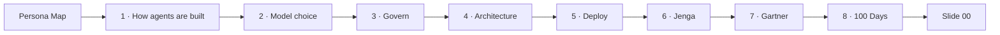

# Build Section — "From Personas to Production"

> **What this is:** the section that follows the persona map. Every track (Upstream, Midstream, Downstream) continues into it. Each slide answers the audience's next question.
> **How we work:** one slide at a time. Build it, review it, commit it, then move to the next.
> **Folder:** `working_deck/build/`

## The flow (agreed 2026-10-10)

| # | Slide | Audience question | File | Status |
|---|---|---|---|---|
| 1 | **How agents are built** | "Horses for courses: a portfolio of agents and agentic workflows" | `page_01_build.html` | **Rebuilt (Aurora):** three panes side by side (Describe / Design / Engineer), each looping slowly; Describe shows Gemini Enterprise → Agents → Create agent → describe; every finished agent lands on the Gemini Enterprise shelf; portfolio bar by build approach (no-code 30–40 %, low-code 20–30 %, high-code 20–30 %, ready-made 10–20 %). Spec: [BUILD_01_HOW_AGENTS_ARE_BUILT.md](BUILD_01_HOW_AGENTS_ARE_BUILT.md) |
| 2 | **Model choice** | "Which AI model, at what cost?" | `page_02_models.html` | **Rebuilt (Aurora):** interactive right-sizing map — pick a task, the quality bar drops, the smallest tier that passes is picked and explained. |
| 3 | **Govern** | "How are they controlled?" | `page_03_govern.html` | **Rebuilt (Aurora):** scenario tabs, official icons on one control lane, persona photo on the request, live audit log. |
| 4 | **Architecture** | "What does an agent look like, and where does it run?" | `page_04_architecture.html` | **Rebuilt — interactive, Aurora theme, official Google Cloud icons** |
| 5 | **Deploy** | "Where do people use them?" | `page_05_deploy.html` | Next |
| 6 | Jenga | Structural resilience | `page_06_resilience.html` | Existing slide, reused |
| 7 | Gartner | Google as a leader | `page_07_gartner.html` | Existing slide, reused |
| 8 | 100 Days | The engagement | `page_08_100_days.html` | Existing slide, reused |

## Agreed defaults (change any time)
- **Aurora theme is mandatory** (see `GEMINI_ENTERPRISE_BRAND_GUIDELINES.md`): Aurora 500 colours only (no legacy `#1A73E8`/`#4285F4`/`#34A853`/`#D93025`), flat Grey 10 / white / Grey 1200 surfaces, no gradient backgrounds or gradient text, gradients only as thin accents from the approved pairs, Google Sans / Google Sans Text / Roboto Mono, `--*-ink` tokens for coloured text. Official product icons live in `assets/media/gcp/`. Pages 1–4 now follow it, via the shared `assets/build.css`.
- **These are web pages, not slides:** use interaction, motion and live state wherever it explains better than static boxes.
- **Build slide:** the portfolio bar includes a **"Ready-made agents 10–20 %"** slice so it adds up to 100 %. It shows percentages only, no agent counts.
- **Animations** are recreated in HTML (no GIF or video), so they work offline and follow light/dark mode.
- **Govern and Architecture** stay as separate slides.
- **Generic pitch:** no company names on any slide.

## Slide content in one line each
1. **How agents are built:** no-code (describe it), low-code (design it), high-code (engineer it); portfolio mix by build approach ≈ 35 % no-code · 25 % low-code · 25 % high-code · 15 % ready-made (planning guide); everything publishes into Gemini Enterprise.
2. **Model choice:** Frontier (Gemini 4 Argon, Claude Opus, Gemini Pro) · Workhorse (Gemini Flash, Sonnet) · Scale (Gemini Flash-Lite, Haiku) · Open weight (Gemma, GLM, Kimi). "The right model for each task: big cost savings, same results." Each tier is mapped to typical persona-map agents.
3. **Govern (interactive):** the presenter picks a situation (routine advice · agent tries to act on the plant · hidden instruction in a document · data asked to leave the country · models disagree). One agent action runs through 8 checkpoints (identity · registry · input safety · tool policy · data boundary · confidence · human approval · audit), with a live audit log and the agent's registry entry.
4. **Architecture:** "Build the agent once, run it where your data and your plant are." Layers, a runs-anywhere band and a governance column, each with named Google products.
5. **Deploy:** Gemini Enterprise as the front door · custom applications (e.g. Cloud Run apps) · inside existing systems (monoliths) · inside processes (headless agents).
6–8. Existing slides, reused as they are.

## To check before a client session
- Gemini Enterprise feature names (Agent Designer, Agent Studio) and the path for publishing high-code agents into Gemini Enterprise.
- That the models on slide 2 are available in Vertex AI Model Garden (especially GLM and Kimi), and that Gemini 4 Argon, which is on a staged rollout, is available to the client.
- What Google Distributed Cloud supports on-premises (slide 4).
