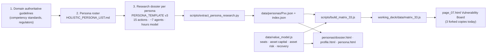
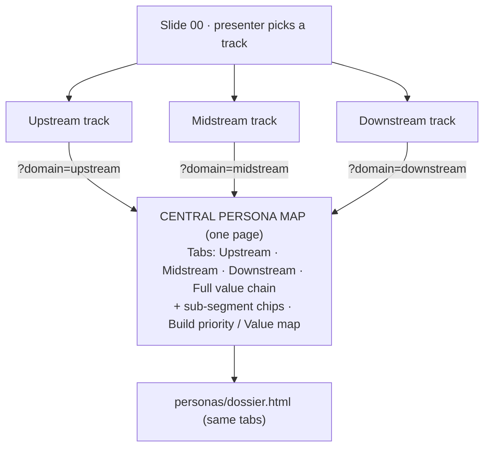

# Current Refinements — Persona Framework

> **Status:** PLAN ONLY. Nothing in this document has been implemented yet.
> **Date:** 2026-10-10 (rev 3 — generic pitch, roles first)
> **Owner:** Amandeep Saini
> **Rule:** One phase at a time. Each phase ends with a verification gate and a separate commit.

---

## 0 · Bottom line

**This is a generic oil and gas pitch. The persona system becomes an open, value-chain-wide set of well-known roles in one central persona map. Midstream and Downstream are built out through research, in a fixed order: right roles first, then the agents for each role, then the ROI.**

1. **Unlock the 33.** Personas become data, so adding or removing one needs no code change, and every count is calculated.
2. **One central persona map**, with tabs for `Upstream | Midstream | Downstream | Full value chain`. Its default tab is the track the presenter started from. The Full value chain tab shows every persona.
3. **Research in sequence:**
   - **Step 1 — roles:** recognisable, standard-anchored roles that people in the industry know, with no clutter.
   - **Step 2 — agents:** the squad for each approved role.
   - **Step 3 — ROI.**
4. **No company names anywhere in the pitch.** Company scale is used **only** as a hidden sizing assumption for the money (see §3.2).

---

## 1 · How the current system works

### 1.1 The pipeline that built the original 33



### 1.2 What one persona carries (`data/personas/Pxx.json`)

| Block | Contents |
|---|---|
| Identity | `id, title, aliases, person, avatar, initials, tier, core20` |
| Classification | `segment`, `segmentLong` (free text, **no domain field**) |
| Role | `oneLine, whyItMatters, notOwned[], variants[], whereTheWorkHappens{}` |
| Evidence | `standards[], citations[], confidence{}, negativeSearch{}` |
| Incumbent stack | `vendorGaps[]` |
| **Actions** | **15** × `{action, bucket, freq, time, friction, today, failureMode, agentRef}` |
| **Agent squad** | **~7** × `{name, oneLine, reads, does, returns, stopsAt, failureModes}` |
| **Value model** | hours before/after per agent + total |

### 1.3 How ROI is built
| Layer | Lives in | Keyed by |
|---|---|---|
| Hours per unit of work | each persona's `valueModel` | persona (company-neutral) |
| Seats, asset capital, asset risk, recovery | `data/value_model.js` | persona only, sized on one combined estate |

Four levers: **PRODUCTIVITY → UPTIME → INTEGRITY → RECOVERY.**

---

## 2 · What's wrong today

| # | Severity | Finding |
|---|---|---|
| F1 | **Blocking** | **No domain model.** `segment` is free text, sorted by regex (`groupFor()` in `build_matrix_33.js`). The board cannot filter by Upstream, Midstream or Downstream. |
| F2 | **Blocking** | **Midstream and Downstream are thin.** Upstream has about 18 dedicated roles. Midstream has about 4 (P14 Pipeline Controller, P15 Terminal Superintendent, P26 Gas Plant Engineer, P27 Pipeline Integrity Engineer). Downstream has 5 (P03, P16, P17, P28, P29). |
| F3 | **Blocking** | **ROI sizing is one blended estate.** Each domain needs its own scale assumption, and shared roles need a headcount per domain. |
| F4 | Important | **"33" is hardcoded** in about 14 files (build script and data file name, dossier counter and chips, profile, index, page_06/07 and the parked pages in every track, NORTH_STAR shares, value-model comments). |
| F5 | Important | **The board is forked three times** (`pages/`, `upstream/`, `midstream/` `page_07.html`). |
| F6 | Minor | **Drift:** the slides say 232 agents, but the data sums to 234. P29 is segmented Downstream but seated under Midstream. IDs P34 and P35 were used by the deleted agent-ideas folder. |

---

## 3 · Target architecture

### 3.1 Open persona registry
New fields on every persona, defined in the roster (`HOLISTIC_PERSONA_LIST.md`) as the single source of truth:

```jsonc
{
  "id": "P36",
  "domains": ["midstream"],        // one or more: upstream | midstream | downstream
  "primaryDomain": "midstream",    // which tab owns it
  "subSegment": "gas-transmission",// explicit grouping, no more regex
  "crossCutting": false            // true → appears in every domain tab
}
```
- New IDs start at **P36**. IDs are never reused or renumbered.
- Every count, total and share is calculated, so the system works the same with 33 personas or 60.

### 3.2 ROI scale: an internal assumption, never shown

| Domain | Scale proxy used for sizing only |
|---|---|
| Upstream | a large national E&P operator (ONGC-sized) |
| Midstream | a large national gas transmission operator (GAIL-sized) |
| Downstream | a large national refiner-marketer (IOCL-sized) |

- These proxies live **only** in the assumption notes of `data/value_model.js`. **No company name appears on any slide, board, dossier or label.**
- Seats, asset capital, asset risk and recovery are keyed **by domain**. A cross-cutting role carries a headcount and value for each domain.
- **Full value chain = Upstream + Midstream + Downstream.** A cross-cutting role shows once per domain (confirmed).
- The formulas stay identical. Only the inputs become domain-aware.

### 3.3 One central persona map


- It replaces the three forked `page_07.html` files. The old ones are parked, not deleted.
- **Default tab = the presenter's starting track.** The order of precedence is URL `?domain=`, then the Slide 00 choice saved in `localStorage`, then Full value chain.
- The headline counts (personas · workflows · agents · ₹) are calculated for the visible tab.

---

## 4 · The research programme

### 4.1 The order is fixed: roles → agents → ROI

| Step | Question it answers | Output | Gate |
|---|---|---|---|
| **R1 · Roles** | *Who are the people in Midstream and Downstream that everyone in the industry recognises?* | A lean roster per domain: title, one-line role, sub-segment, authoritative anchor, overlap check against the existing 33 | **You approve the roster** |
| **R2 · Actions** | *What does each role actually do, and where does it break?* | 15 cited actions per role (bucket, frequency, time, friction, failure mode) | Template v3 §3 checklist |
| **R3 · Agents** | *Which agent squad removes that friction?* | About 7 agents per role (reads / does / returns / stopsAt) plus the hours model | Template v3 §4 checklist |
| **R4 · ROI** | *What is it worth at scale?* | Seats, asset capital, risk and recovery per role, using the domain scale proxy | Totals table vs baseline approved |

### 4.2 R1 rules — the right roles, no clutter

1. **Recognisable title.** A 1–3 word title that a practitioner would use about themselves (e.g. "Pipeline Controller", "Shift Supervisor"). No invented or niche variants.
2. **Authoritative anchor.** Each role is backed by a published competency standard, regulator or professional body (OISD, PNGRB, PESO, API, ASME, ISA, AMPP/NACE, AGA, Energy Institute, IChemE, CCPS…).
3. **Knowledge work.** The role makes decisions, judgements or documented checks that an agent can prepare. Purely manual or life-safety-authority roles are excluded.
4. **No duplicates.** If an existing persona covers 70% or more of the role, **extend that persona** rather than create a new one.
5. **No company or site framing.** Roles are described generically ("gas transmission network", "refinery", "marketing terminal"), never by named plants or brands.
6. **Lean by design.** Each domain's roster is kept at a size a CXO can scan on one screen. Merge adjacent specialisms into the role people actually know.

### 4.3 R1 search space — generic value-chain sub-segments

These are **where to look**, not the roster.

| Midstream | Downstream |
|---|---|
| Gas & liquids transmission / network control | Refinery operations |
| Compression & pumping stations | Process & technology engineering |
| Pipeline integrity & corrosion | Planning, scheduling & economics |
| Measurement & custody transfer | Blending & product quality / laboratory |
| Gas processing | Offsites, tank farms & oil movement |
| LNG & marine terminals | Utilities & energy |
| Storage | Petrochemicals |
| Commercial: capacity, nominations, contracts | Distribution: product pipelines, terminals & depots |
| Gas distribution networks | Marketing & retail fuels (incl. LPG, aviation, lubricants) |

Cross-cutting roles (process safety, reliability, inspection, turnaround, instrumentation, environment) already exist and are tagged across all three domains.

### 4.4 Existing personas — reclassify only
- **Upstream:** P01, P02, P04–P11, P18, P21–P25, **P12** (offshore facilities), **P13** (flow assurance, secondary midstream).
- **Midstream:** P14, P15, P26, P27. P14, P15 and P27 are also tagged downstream (product pipelines and terminals).
- **Downstream:** P03, P16, P17, P28, P29.
- **Cross-cutting:** P19, P20, P30, P31, P32, P33.
- R1 also checks whether P14 and P27 (anchored on US DOT / API) need regulator anchors added. That would be a dossier revision, not a new persona.

### 4.5 Volume
Each new role costs the same as an original one: 15 actions, about 7 agents, an hours model and ROI entries. The final numbers depend on the R1 roster you approve. R2–R4 run in parallel batches with a review gate per batch.

---

## 5 · Execution plan — step by step

| Phase | What | Size | Gate |
|---|---|---|---|
| **0 · Baseline** | Tag `persona-baseline-33`. Record personas, cells, agents and ₹ by lever. Reconcile 232 vs 234. | S | Baseline recorded |
| **1 · Unlock structure** | Add domain fields to the roster and extract script. Remove the regex grouping. Rename `build_matrix_33` → `build_matrix`. Remove every "33" literal. | M | Deck renders identically. Removing one persona leaves no broken totals |
| **2 · Domain-aware ROI** | Restructure `value_model.js` by domain using the scale proxies. Re-price the existing personas. | M | Per-domain totals with deltas vs baseline approved |
| **3 · Central persona map** | One page with domain tabs, sub-segment chips and the default from the starting track. Re-point Stage 07 in every track. Add the same tabs to the dossier roster. | M | Screenshots of all four tabs. Totals tie out |
| **4 · R1 Roles** | Research the Midstream and Downstream rosters per §4.2–4.3. | L | **Roster approved by you** |
| **5 · R2–R3 Actions & agents** | Dossiers per template v3, in parallel batches by sub-segment. Extract, then add names and portraits. | XL | Template checklist per batch |
| **6 · R4 ROI & narrative** | Add value-model entries. Update slide copy that quotes totals. Unlock and re-lock the chessboard slide. | M | Final review, commit, push |

Phases 1–3 (structure) can run **in parallel** with Phase 4 (roles research).

---

## 6 · Decisions

**Confirmed**
- A generic oil and gas pitch, with no company or site names anywhere visible.
- Company scale is used only as a hidden sizing assumption for ROI.
- The 33 is unlocked. One central persona map with domain tabs and a Full value chain tab. The default follows the starting track.
- Full value chain = the three domains summed, with cross-cutting roles shown once per domain.
- Research order: right roles first, then agents per role, then ROI. Rosters stay lean and recognisable.

**Open:** none blocking. Phase 0 and Phase 4 (R1 roles) can start on your go-ahead.

---

## 7 · Risks

| Risk | Mitigation |
|---|---|
| Roster bloat | R1 rules 1, 4 and 6, plus your approval gate before any dossier work |
| New research below the original 33's quality | Same template v3 and checklist; authoritative anchor mandatory |
| ₹ totals shift once sizing is per domain | Phase 2 gate shows every delta before a slide changes |
| A company name leaking into the visible deck | Grep check for company names in every phase gate |
